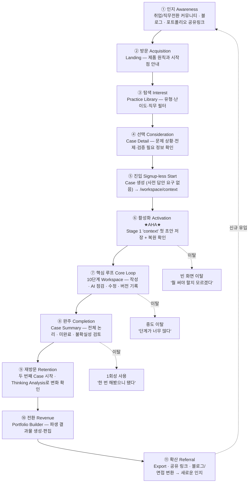

# Thinking Flow — 서비스 퍼널 설계도

> 기준 문서: `E:\thinking_flow\docs\` (V1) + `E:\thinking_flow\docs\v2\` (V2 설계)
> 작성일: 2026-08-03 · 이 폴더는 참고용 산출물이며 원본 프로젝트 폴더를 수정하지 않는다.

---

## 0. 이 퍼널의 특징 — 왜 일반 SaaS 퍼널과 다른가

Thinking Flow는 "결과물을 빠르게 뽑아주는 도구"가 아니라 **사용자가 먼저 생각하게 만드는 학습 서비스**다.
따라서 퍼널 설계의 전제가 두 가지 다르다.

| 일반 AI 툴 퍼널 | Thinking Flow 퍼널 |
| --- | --- |
| 마찰(friction)을 0에 가깝게 줄이는 것이 선(善) | **의도된 마찰**이 곧 제품 가치 (사용자 선작성 → AI 후개입) |
| Aha = "AI가 결과를 만들어줬다" | Aha = **"내가 쓴 초안이 구조로 정리되고, 그 변화가 기록됐다"** |
| 이탈 방지 = 자동화 | 이탈 방지 = **빈 화면 공포 제거 + 진행 상태 보존 + Soft Gate** |

핵심 리스크는 명확하다. **10단계는 길고, 사용자는 스스로 써야 한다.**
그래서 이 퍼널의 승부처는 유입이 아니라 **Stage 1(목적·맥락 이해) 첫 저장**과 **10단계 완주**다.

---

## 1. 전체 퍼널 구조 (Macro Funnel)

---

## 2. 단계별 상세 설계

각 단계는 **목표 / 사용자 심리 / 화면 / 핵심 지표 / 이탈 원인 / 대응 설계** 로 정의한다.
지표의 목표 수치는 아직 검증되지 않은 **가설값**이며, 실제 데이터 확보 후 재설정한다.

---

### ① 인지 (Awareness)

| 항목 | 내용 |
| --- | --- |
| **목표** | "AI로 결과는 뽑는데 내 사고력이 안 늘어난다"는 자각을 건드린다 |
| **사용자 심리** | "포트폴리오에 결과물은 있는데, 면접에서 '왜 그렇게 판단했냐'를 못 답하겠다" |
| **채널 가설** | 취업/직무전환 커뮤니티, 데이터·PM 직군 뉴스레터, 사고법 콘텐츠(SEO), **기존 사용자의 포트폴리오 공유 링크** |
| **메시지** | "AI가 대신 생각하게 두지 마세요. 생각하는 절차를 훈련하세요." |
| **지표** | 유입 세션 수, 채널별 랜딩 도달률, 공유 링크 경유 유입 비중 |

> **설계 포인트** — 이 서비스의 가장 강한 인지 채널은 광고가 아니라 **⑪ 확산 단계에서 생성되는 사용자 포트폴리오**다.
> 포트폴리오 자체가 "이 사람은 이런 절차로 생각했다"를 보여주는 콘텐츠이므로, 그 하단의 출처 표기가 곧 유입 경로가 된다.

---

### ② 방문 (Acquisition) — Landing

| 항목 | 내용 |
| --- | --- |
| **목표** | 3초 안에 "AI가 답을 주는 서비스가 아니다"를 이해시키고 Practice Library로 보낸다 |
| **화면 책임** | 제품 원칙과 시작점 안내 (`08_V2_UX_ARCHITECTURE.md` §2) |
| **필수 요소** | ⓐ 한 문장 정의 ⓑ 사용 전/후 비교표 ⓒ 10단계 미리보기 ⓓ 실제 Case 카드 3개 ⓔ 단일 CTA |
| **지표** | Landing → Library 이동률, 체류 시간, 10단계 미리보기 열람률 |
| **이탈 원인** | "또 하나의 AI 글쓰기 툴"로 오인 → 즉시 이탈 |
| **대응 설계** | `01_V2_PRODUCT_VISION.md` §4의 **사용 전/후 대조표를 랜딩 히어로 바로 아래에 배치**. "AI에게 바로 답을 요청한다 → 자신의 초안을 먼저 작성한다"가 가장 강한 차별화 문장이다 |

---

### ③ 탐색 (Interest) — Practice Library

| 항목 | 내용 |
| --- | --- |
| **목표** | "나랑 상관있는 문제"를 30초 안에 찾게 한다 |
| **화면 책임** | 유형·난이도·추천 직무·예상 시간·포트폴리오 가능 여부 필터, 진행 상태 구분 |
| **Case 유형** | 서비스 문제 / 데이터 분석 / 업무 개선 / 프로젝트 회고 / 기업 Case / 자유 주제 / 면접 Case / 일상 문제 |
| **난이도** | 입문 · 기본 · 심화 · 도전 |
| **지표** | 필터 사용률, Case Detail 진입률, 카드당 노출 대비 클릭률 |
| **이탈 원인** | 선택지 과다 · 자기 직무와의 연결 실패 · "어려워 보임" |
| **대응 설계** | ⓐ 첫 방문자에게는 **입문 난이도 + 일상 문제 유형을 우선 노출** (진입 장벽 최소화) ⓑ 카드에 예상 소요 시간 명시 ⓒ "처음이라면 이것부터" 단일 추천 슬롯 |

---

### ④ 선택 (Consideration) — Case Detail

| 항목 | 내용 |
| --- | --- |
| **목표** | 문제의 범위와 "내가 할 일"을 명확히 해 시작 결심을 만든다 |
| **화면 요소** | 제목·요약·유형·난이도 / 문제 상황과 **업무 요청(businessRequest)** / 알려진 전제 + `사실·가상 설정·가정` 배지 / 검증 필요 정보 / 추천 대상 / 사용 가능 프레임워크 / 예상 산출물 / 포트폴리오 전환 가능성 |
| **지표** | Detail → Case 시작 전환율 |
| **이탈 원인** | "정답이 없다"는 점에 대한 불안, 소요 시간 부담 |
| **대응 설계** | ⓐ **"이 Case에 정답은 없습니다. 두 가지 이상의 합리적 접근이 가능합니다"를 명시** (Seed 기준 §7과 일치) ⓑ "언제든 중단하고 이어서 할 수 있습니다" 보존 약속을 시작 버튼 옆에 배치 |

---

### ⑤ 진입 (Start) — Case 생성

| 항목 | 내용 |
| --- | --- |
| **목표** | 마찰 없이 Workspace 첫 화면(`context`)까지 보낸다 |
| **확정 정책** | 시작 전 `initialImpression`, `initialSolutionIdea`, `decisionQuestion`을 **받지 않는다**. 첫 생각은 Stage 1 안에서 작성한다 |
| **지표** | **Case 시작률** (Detail 진입 대비) |
| **이탈 원인** | 시작 전 양식 요구, 로그인 요구 |
| **대응 설계** | 로그인·결제 게이트를 이 지점에 두지 않는다. 로컬 저장(localStorage, `schemaVersion: 3`) 기반으로 **가입 없이 첫 Case를 끝까지 경험**할 수 있게 한다 |

> **의사결정 필요** — 로그인·서버 저장을 어느 시점에 요구할지는 원본 문서에서도 Open Decision이다(`10_V2_DEVELOPMENT_ROADMAP.md` §4).
> 퍼널 관점의 권고: **⑧ 완주 직후 또는 ⑩ 포트폴리오 생성 시점**이 가장 낮은 이탈로 계정을 요구할 수 있는 지점이다. 이때 사용자는 이미 잃을 것(자기 사고 기록)이 생겼기 때문이다.

---

### ⑥ 활성화 (Activation) ★ 이 퍼널의 핵심 ★

| 항목 | 내용 |
| --- | --- |
| **Aha Moment 정의** | **Stage 1 `context`에서 자신의 초안을 작성하고 저장한 뒤, 새로고침해도 그대로 복원되는 것을 확인한 순간** |
| **왜 여기인가** | 이 순간에 ⓐ "빈 화면에서 시작할 수 있다" ⓑ "내 문장이 사라지지 않는다" ⓒ "AI가 대신 쓰지 않는다"는 세 가지 제품 약속이 동시에 증명된다 |
| **지표(1순위)** | **첫 Case에서 `context` 초안을 작성한 사용자 비율** — 이 서비스 전체에서 가장 중요한 단일 지표 |
| **보조 지표** | 첫 저장까지 걸린 시간, 자유 작성/구조화 입력 선택 분포, mode 전환 발생률 |
| **이탈 원인 (최대 리스크)** | **빈 화면 공포.** "뭘 써야 하지"에서 그대로 창을 닫는다 |
| **대응 설계** | ⓐ **짧은 자유 작성 우선 권장** — 완성도 낮은 3줄이라도 먼저 쓰게 하고, 이후 구조화 질문으로 빠진 요소를 보완 (`00_V2_MASTER_CONTEXT.md` §9-2) ⓑ 좋은 예시/나쁜 예시를 보여주되 **입력값으로 삽입하지 않는다** (V2-02 테스트 조건) ⓒ AI Coach는 `locked` 상태를 유지하되, **왜 잠겨 있는지** 문구로 설명 ⓓ 저장 완료 상태를 명시적으로 표시 |

> **경고** — 여기서 마찰을 줄이겠다고 AI 초안 자동 생성을 넣는 순간 제품이 붕괴한다(`01_V2_PRODUCT_VISION.md` §7 비목표).
> 마찰은 **예시·질문·템플릿**으로 낮추고, **대신 써주기**로는 낮추지 않는다.

---

### ⑦ 핵심 루프 (Core Loop) — 10단계 Workspace

이 단계는 그 자체가 하나의 마이크로 퍼널이다. → §3에서 별도 상세.

| 항목 | 내용 |
| --- | --- |
| **목표** | Stage 1에서 검증된 작성 경험을 10단계 끝까지 반복시킨다 |
| **화면 구조** | 3열 — 좌: 10단계 Flow + `n/10` / 중: 학습 콘텐츠 + 작성 / 우: AI Coach(`locked → ready`) |
| **루프 단위** | `학습 설명 확인 → 직접 작성 → 저장 → AI 점검 요청 → 피드백 채택·거절 → 수정(버전 append) → 다음 단계` |
| **지표** | 단계별 진입률·완료율·소요 시간, AI 점검 요청률, **피드백 채택률 vs 거절률**, 단계당 평균 version 수 |
| **이탈 원인** | 단계 피로 · 후반부 단계(8~10)의 체감 가치 하락 · Soft Gate를 "혼나는 느낌"으로 인식 |
| **대응 설계** | ⓐ `n/10` 진행률 상시 노출 ⓑ **Soft Gate는 차단이 아니라 안내** — "계속 이동" 항상 허용, 이동만으로 완료 처리하지 않음 ⓒ 후반 단계에서 **앞 단계 내 답변을 인용해 보여주기**(내 사고가 쌓이고 있다는 체감) ⓓ 중간 이탈자에게 "이어서 하기" 복귀 동선 확보 |

> **피드백 채택률에 대하여** — AI 피드백을 **거절한 기록도 사용자의 판단 데이터**다(`00_V2_MASTER_CONTEXT.md` §9-6).
> 따라서 채택률이 높은 것이 좋은 것이 아니다. 거절률이 0에 수렴하면 오히려 "AI 말을 그대로 따르는 중"이라는 경고 신호로 해석해야 한다.

---

### ⑧ 완주 (Completion) — Case Summary

| 항목 | 내용 |
| --- | --- |
| **목표** | "내가 이걸 다 해냈다"는 완결감 + 자기 논리의 빈틈 자각 |
| **화면 책임** | 10단계 산출물의 현재 버전, 미완료 항목, 불확실성 검토 (내부 학습 산출물) |
| **지표** | **전체 Case 완료율**, Summary 열람률, Summary에서 원본 Stage로 되돌아간 비율 |
| **이탈 원인** | 완료 후 다음 행동이 없음 → 세션 종료 |
| **대응 설계** | Summary 하단에 **다음 행동 3개를 병렬 제시** — ⓐ 포트폴리오로 변환 ⓑ 두 번째 Case 시작 ⓒ 미완료 항목 보완. 특히 ⓑ를 놓치면 ⑨ 재방문이 통째로 무너진다 |

---

### ⑨ 재방문 (Retention) — 두 번째 Case & Thinking Analysis

| 항목 | 내용 |
| --- | --- |
| **목표** | 1회성 체험을 **반복 훈련 습관**으로 전환한다 |
| **핵심 지표** | **두 번째 Case를 시작한 사용자 비율** — 학습 서비스의 생존 지표 |
| **보조 지표** | 단계별 소요 시간 변화, AI 점검 없이 완료한 단계 수 증가, 반복 취약점 감소 |
| **Analysis 화면 책임** | 패턴·변화를 metric 카드로 보여주고, **모든 카드에서 원본 Stage와 계산 근거로 이동 가능** |
| **이탈 원인** | 첫 Case 완료 후 성취가 소진됨 · 두 번째 Case의 새로움 부족 |
| **대응 설계** | ⓐ **Analysis는 Case 1개만으로는 성립하지 않는다** — "2번째 Case를 완료하면 비교 분석이 열립니다"를 명시적 동기로 사용 ⓑ 첫 Case와 다른 유형/난이도를 추천 ⓒ 반복할수록 도움을 줄인다는 원칙(`02_PRODUCT_CORE.md`)을 성장 피드백으로 시각화 |

> **주의** — 성장 metric은 근거 없는 역량 점수나 사용자 간 순위로 만들지 않는다(V2-08 제외 범위).
> 게임화로 리텐션을 만들려는 유혹이 크지만, 그 순간 "사고 훈련"이 "점수 따기"로 변질된다.

---

### ⑩ 전환 (Revenue) — Portfolio Builder

| 항목 | 내용 |
| --- | --- |
| **목표** | 축적된 사고 기록을 **외부에 보여줄 수 있는 형태**로 바꿔주며, 여기서 지불 의사가 발생한다 |
| **생성 조건** | 핵심 Stage 원본 저장 / 결과가 실제인지 계획인지 구분 / 민감 정보·출처 검토 / **사용자의 명시적 요청** / 생성 후 사용자 검토·수정 |
| **파생 유형** | Case별 포트폴리오(1순위) → 역량 포트폴리오 → 직무별 변환(PM·데이터 분석·서비스 기획) → 기술 블로그 → 면접 답변 |
| **지표** | Portfolio 생성률, 섹션 편집률, **포트폴리오에서 원본 기록을 다시 검토한 비율** |
| **수익화 후보 지점** | 무료: Case 수행 + Case Summary / 유료 후보: 직무별 변환, 면접 답변 변환, 다수 Case 역량 포트폴리오, Export 포맷 확장 |
| **대응 설계** | 원본에 없는 성과·역할·수치를 생성하지 않는다. 이 제약이 오히려 **"이 포트폴리오는 조작이 아니다"는 신뢰**가 되어 지불 근거가 된다 |

> `03_LEAN_PRD.md`는 결제를 제외 범위로 명시하고 있다. 위 수익화 지점은 **퍼널 설계상의 후보**이며 현재 제품 결정이 아니다.

---

### ⑪ 확산 (Referral) — Export & 공유

| 항목 | 내용 |
| --- | --- |
| **목표** | 사용자의 결과물이 새로운 사용자의 인지 채널이 된다 |
| **화면 책임** | preview → 공개 범위 확인 → export / 공유 링크 → 철회 |
| **지표** | Export 실행률, 공유 링크 생성률, 공유 링크 경유 신규 유입 수 |
| **안전 장치** | 기본 비공개 / 섹션별 공개 여부와 전체 공개 여부 분리 / 원본 사고 기록은 자동 공개되지 않음 / 기업명·개인정보·AI 대화 포함 여부 게시 전 확인 / 공유 철회와 export 후 통제 한계 안내 |
| **대응 설계** | 공유 자체를 강요하지 않되, **공개된 포트폴리오 하단에 "이 사고 과정은 Thinking Flow 10단계로 작성되었습니다" 출처 블록**을 기본 포함(사용자가 끌 수 있음) |

---

## 3. 마이크로 퍼널 — 10단계 Workspace 내부

가장 많은 이탈이 발생할 구간이므로 단계별로 별도 관리한다.

| # | Stage key | 표시명 | 퍼널상 역할 | 예상 이탈 위험 |
| ---: | --- | --- | --- | :---: |
| 1 | `context` | 목적·맥락 이해 | **Activation 지점.** 첫 초안 저장 | 🔴 최고 |
| 2 | `observation` | 현상 관찰 | 사실·해석 분리 첫 훈련 | 🟠 높음 |
| 3 | `problem_definition` | 문제 정의 | **첫 번째 "성장 체감" 지점** | 🟡 중간 |
| 4 | `problem_structuring` | 문제 분해·구조화 | MECE 등 프레임워크 첫 적용 | 🟠 높음 |
| 5 | `hypothesis` | 가설 설정 | 복수 가설 작성 | 🟡 중간 |
| 6 | `evidence_validation` | 근거 수집·검증 | **인지 부하 최대 구간** | 🔴 최고 |
| 7 | `decision` | 대안 비교·의사결정 | 기준·가중치 결정 | 🟡 중간 |
| 8 | `solution_execution` | 해결안 설계·실행 | 산출물 체감 회복 | 🟢 낮음 |
| 9 | `result_evaluation` | 결과 평가 | 완주 임박 | 🟢 낮음 |
| 10 | `conclusion_reflection` | 결론 전달·회고 | **완결 + 포트폴리오 진입** | 🟢 낮음 |

### 위험 구간 3곳과 대응

**🔴 Stage 1 `context` — 빈 화면 공포**
→ 짧은 자유 작성 우선 / 예시 노출(삽입 금지) / 저장 상태 명시 / AI locked 이유 설명

**🟠 Stage 2·4 — "사실과 해석을 나누라니, 어떻게?"**
→ 구조화 입력 템플릿을 강하게 제공. 자유 작성이 막히는 사용자에게 mode 전환을 능동 제안.
   Case Detail에서 이미 제공한 `knownPremises[]` / `informationToValidate[]`를 이 단계에서 재사용 가능한 재료로 노출

**🔴 Stage 6 `evidence_validation` — 인지 부하 최대**
→ 이 단계에 도달한 사용자는 이미 절반 이상 투자했으므로 **완주 유도가 가장 효율적**.
   ⓐ "남은 4단계" 명시 ⓑ 근거가 부족해도 "불확실"로 표시하고 넘어갈 수 있음을 안내(Soft Gate) ⓒ 완벽한 검증을 요구하지 않음을 학습 콘텐츠에서 선언

---

## 4. 지표 체계

### 4.1 퍼널 전환 지표 (`03_LEAN_PRD.md` 기준)

| 순번 | 지표 | 정의 |
| ---: | --- | --- |
| F1 | Case 시작률 | Case Detail 진입 → Case 생성 |
| F2 | Step 2 진입률 | Stage 1 저장 → Stage 2 진입 |
| F3 | 문제 정의 완료율 | Stage 3 완료 |
| F4 | 전체 Case 완료율 | Stage 10 도달 |
| F5 | Report 생성률 | Case Summary 열람 |
| F6 | Portfolio Preview 생성률 | Portfolio 생성 |

### 4.2 활성화·리텐션 지표 (`01_V2_PRODUCT_VISION.md` §8 기준)

- 첫 Case에서 `context` 초안을 작성한 사용자 비율 ← **North Star 후보**
- 시작한 Case 중 10단계까지 도달한 비율
- 사용자가 AI 점검 전에 먼저 작성한 비율
- Case별 의미 있는 수정과 checkpoint 수
- 근거·출처가 연결된 판단 비율
- 두 번째 Case를 시작한 사용자 비율 / 단계별 소요 시간 변화
- 포트폴리오 변환 후 원본 기록을 다시 검토한 비율

### 4.3 사고 품질 지표 (제품 고유 — 경쟁사가 못 만드는 지표)

사실·해석 분리율 / 가설 4개 이상 작성률 / 대안 가설 작성률 / 기각 조건 작성률 /
검증 지표 작성률 / 성공·수정·중단 기준 작성률 / 최초·최종 판단 비교 완료율

### 4.4 지표 사용 원칙

1. 모든 표시 metric은 **계산식과 원본 기록으로 설명 가능**해야 한다.
2. 근거 없는 역량 점수와 **사용자 간 순위는 만들지 않는다.**
3. "AI 의존도" 같은 민감 지표의 공정한 정의는 아직 Open Decision이다.
4. 목표 수치는 실제 사용 데이터 확보 전까지 설정하지 않는다.

---

## 5. 퍼널 누수 우선순위

투자 대비 효과 순으로 정렬한 개선 순서.

| 우선순위 | 구간 | 문제 | 개선 레버 | 근거 |
| :---: | --- | --- | --- | --- |
| **1** | ⑥ Activation | 빈 화면 이탈 | 짧은 자유 작성 우선 + 예시 + 구조화 질문 보완 | 여기가 막히면 이후 전 단계가 0 |
| **2** | ⑦ Stage 6 | 인지 부하로 중도 이탈 | Soft Gate 안내 + 잔여 단계 명시 + 불확실 허용 | 이미 절반 투자한 사용자 = 회수 효율 최대 |
| **3** | ⑨ Retention | 1회성 사용 | Summary 하단 3-CTA + "2번째 Case에서 분석 해금" | 학습 서비스의 생존 지표 |
| **4** | ③ Library | 자기 문제 연결 실패 | 입문·일상 유형 우선 노출 + 단일 추천 슬롯 | 유입은 있으나 선택 실패 |
| **5** | ⑪ Referral | 확산 채널 부재 | 포트폴리오 출처 블록 (기본 on, 끌 수 있음) | 유일한 자연 유입 채널 |

---

## 6. 현재 구현 상태와 퍼널의 대응

| 퍼널 단계 | 구현 상태 | 관련 Task |
| --- | --- | --- |
| ①②③④⑤ | ✅ 구현됨 (Landing, Practice Library, Case Detail, Case 시작) | V1 Task 04까지 |
| ⑥ Activation | ⚠️ **Shell만 존재, 실제 입력·저장 미구현** | V2-02, V2-03 |
| ⑦ Core Loop | ⚠️ 3열 Shell·10단계 내비게이션·Soft Gate 골격만 존재 | V2-05, V2-06, V2-07 |
| ⑧ Completion | ❌ 미구현 | — |
| ⑨ Retention | ❌ 미구현 | V2-08 |
| ⑩ Revenue | ❌ 미구현 | V2-09 |
| ⑪ Referral | ❌ 미구현 | V2-10 |

> **퍼널 관점의 로드맵 해석** — 현재 퍼널은 **⑤에서 ⑥으로 넘어가는 지점이 끊겨 있다.**
> 유입을 늘리는 어떤 활동도 지금은 의미가 없고, **V2-02 / V2-03(Context 입력·저장·복원)이 사실상 이 서비스의 첫 번째 퍼널 복구 작업**이다.
> 로드맵이 이 두 Task를 앞에 둔 것은 퍼널 관점에서도 정확한 판단이다.
